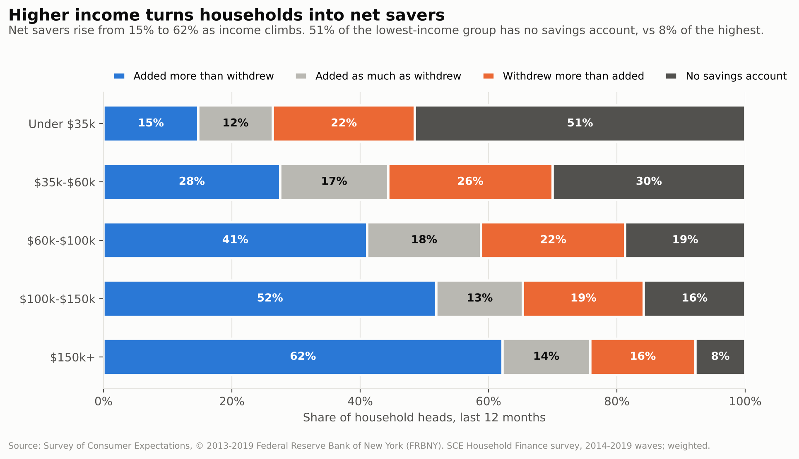
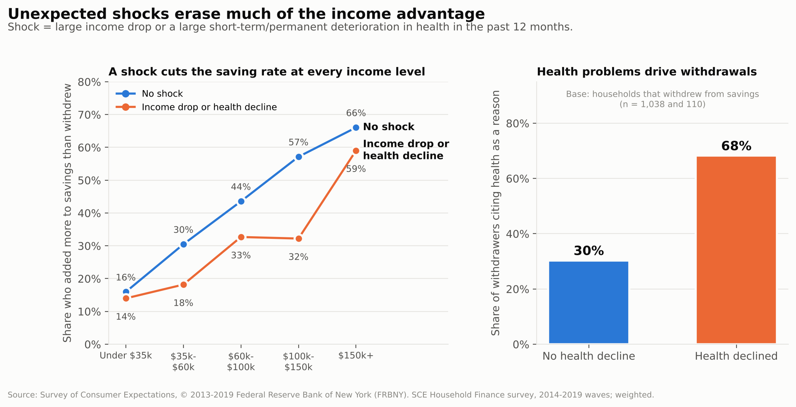
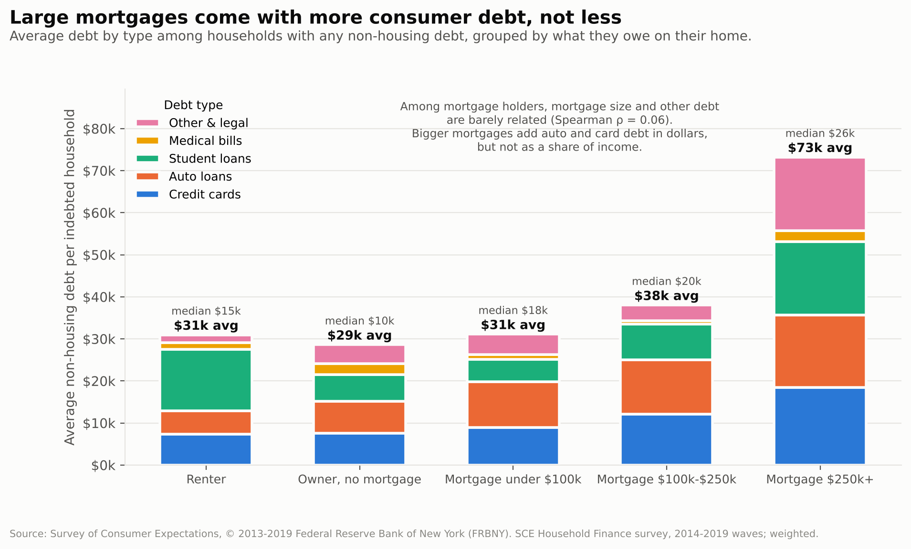
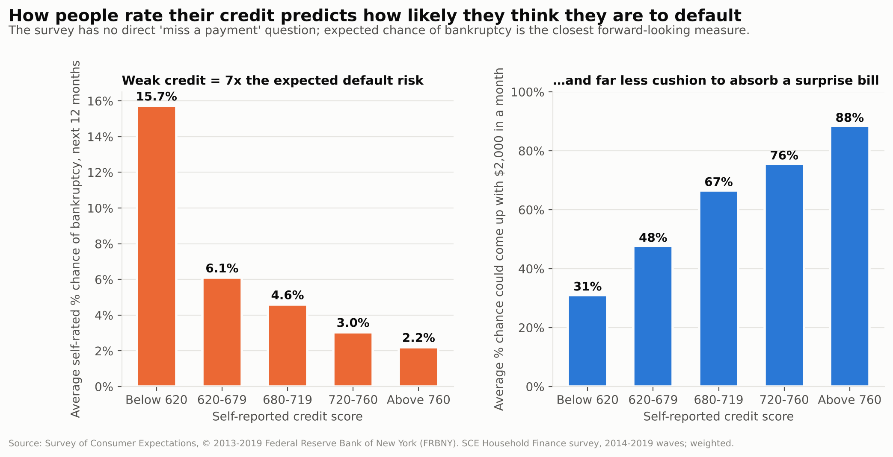
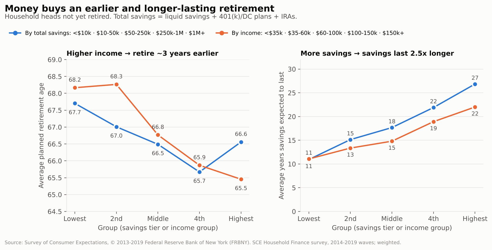
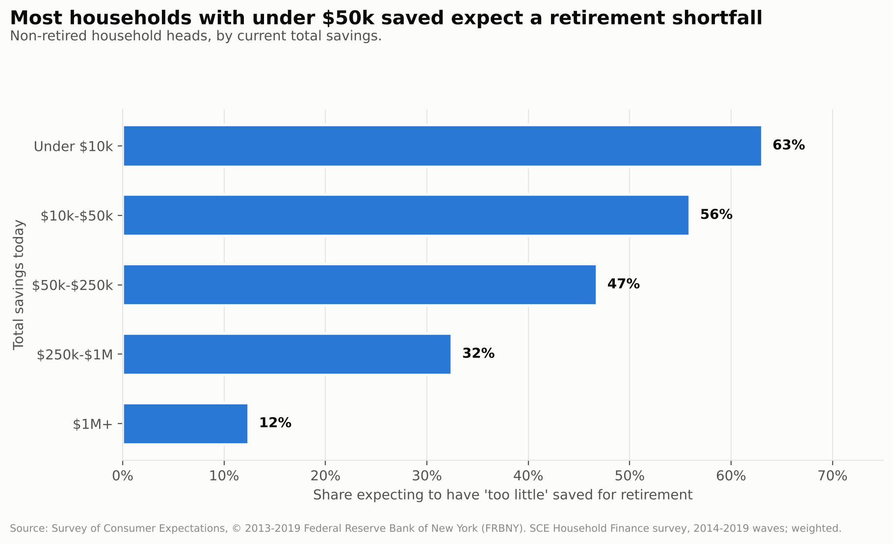

# Household Financial Resilience — Income, Debt, Shocks & Retirement

**Advanced Data Analytics — Tableau Project** · **Team Grit**

How do income, debt and savings shape a household's day-to-day financial choices, its debt risk, and its retirement plans? We answer three research questions using 6,809 responses from the Federal Reserve Bank of New York's **Survey of Consumer Expectations (SCE) — Household Finance** microdata (2014–2019).

📄 **Full report:** [`report/Business_Case_Report.md`](report/Business_Case_Report.md)

---

## Research questions

1. **RQ1:** How does a household's income affect whether it saves money or takes on debt, and how do those choices change when it has unexpected financial or health problems?
2. **RQ2:** How does the amount a household owes on its home relate to its other debt (credit cards, car loans, student loans, medical bills)? Does how people feel about their credit affect how likely they think they are to fall behind on payments?
3. **RQ3:** How do current savings and income affect when someone plans to retire and how long they expect their savings to last?

## Key findings

| | Finding |
|---|---|
| 💰 | **62%** of $150k+ households are net savers vs **15%** under $35k; **51%** of the lowest-income group has no savings account. |
| ⚠️ | A large income drop or health decline cuts the net-saver rate at every income level (e.g. $100–150k: 57% → 32%). **68%** of withdrawers whose health declined cite health as a reason. |
| 🏠 | Indebted households with a $250k+ mortgage carry **~$73k** of other debt (vs ~$29–38k), but the lowest debt-to-income ratio. Mortgage size and other debt are barely related (ρ = 0.06). |
| 📉 | People who rate their credit **below 620** give themselves a **15.7%** chance of bankruptcy next year, **7x** the 2.2% of those above 760. |
| 🧓 | $150k+ earners plan to retire **~2.8 years earlier**; $1M+ savers expect savings to last **27 years** vs **11** for under $10k. |








## Repository structure

```
├── README.md                          ← you are here
├── report/
│   └── Business_Case_Report.md        ← business case, objectives, method, findings, recommendations
├── data/
│   ├── DATA_SOURCE.md                 ← where the data comes from + how to download it
│   ├── codebook.csv                   ← FRBNY variable definitions & answer codes
│   ├── raw/SCE_Household_Finance_2014_2019.xlsx   ← original FRBNY workbook (Data, Codebook, License, Disclaimer)
│   └── processed/sce_household_finance_clean.csv  ← cleaned, labeled file used by Python & Tableau
├── src/
│   ├── 01_clean_data.py               ← raw workbook → cleaned CSV
│   └── 02_analysis_and_charts.py      ← weighted analysis → outputs/ tables + figures/ charts
├── outputs/                           ← summary tables behind every number in the report (CSV)
├── figures/                           ← final annotated charts (PNG)
├── tableau/                           ← Tableau workbook / dashboard screenshots
└── requirements.txt
```

## Method in brief

- **Tools:** Python (pandas, numpy, matplotlib) for cleaning, survey-weighted statistics and charts; **Tableau** for the interactive dashboards. Both use the same cleaned file.
- **Weights:** all shares, means and medians use FRBNY's survey weight (`quarterly_weights`), so results describe U.S. household heads.
- **Derived measures:** income groups, saving behavior, income and health shocks, housing-debt tiers, debt mix in dollars, total savings (liquid + 401k/DC + IRA), and retirement expectations. Full definitions are in the report, §4.
- **Association, not causation:** each wave is a cross-section, so we report group comparisons and Spearman correlations.

## Reproduce

```bash
pip install -r requirements.txt
python src/01_clean_data.py
python src/02_analysis_and_charts.py
```

To rebuild the dashboards in Tableau, connect to `data/processed/sce_household_finance_clean.csv`, put `weight` on the measure as a weighted average (e.g. `SUM([net_saver]*[weight]) / SUM(IIF(ISNULL([net_saver]),0,[weight]))`), and use the `income_group`, `housing_debt_tier`, `credit_rating` and `savings_tier` dimensions.

## Data attribution

Source: Survey of Consumer Expectations, © 2013–2019 Federal Reserve Bank of New York (FRBNY). The SCE data are available without charge at <http://www.newyorkfed.org/microeconomics/sce> and may be used subject to license terms posted there. FRBNY disclaims any responsibility or legal liability for this analysis and interpretation of Survey of Consumer Expectations data.
