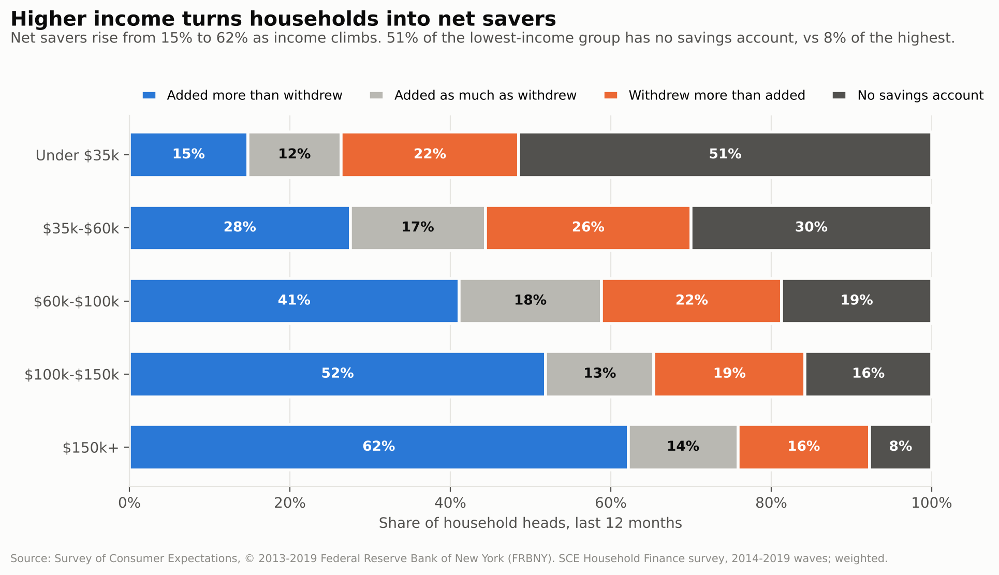
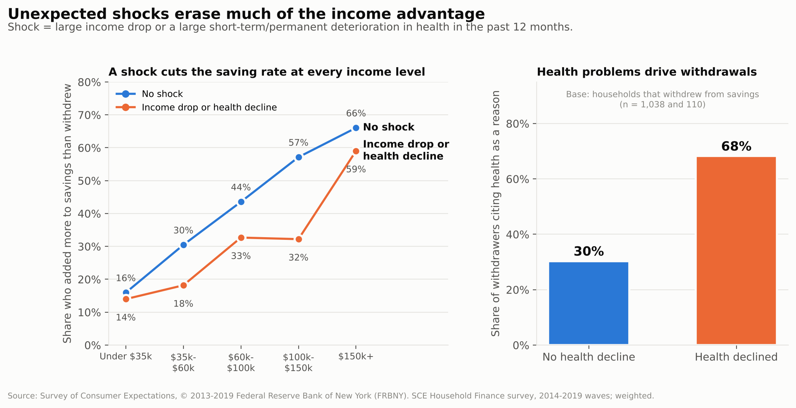
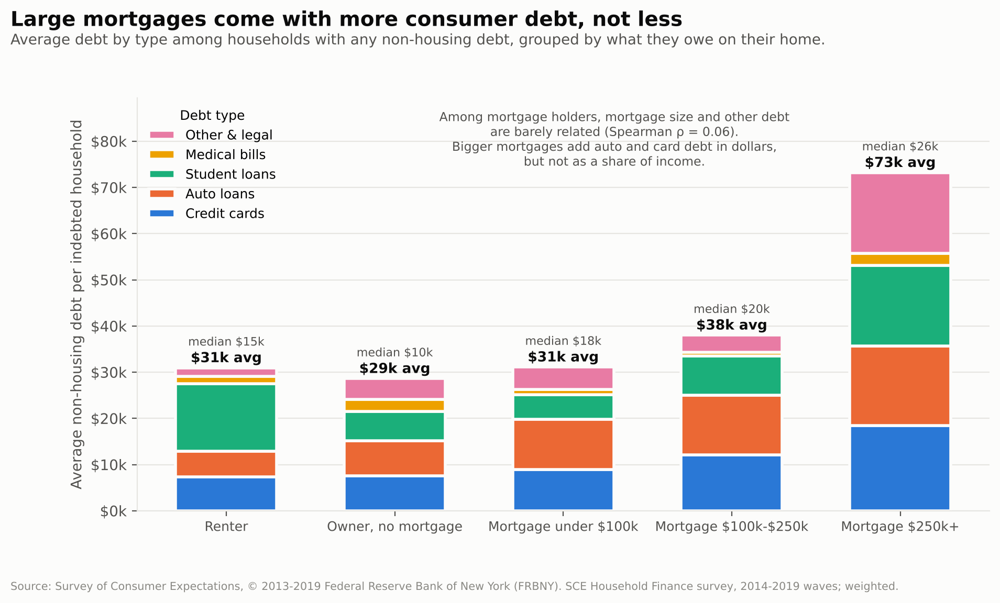
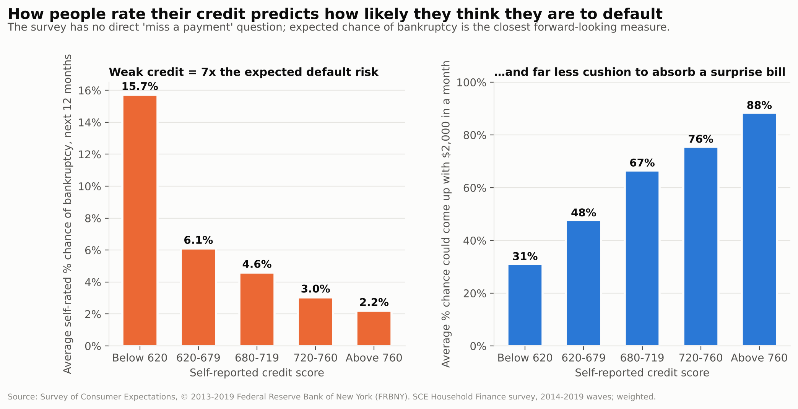
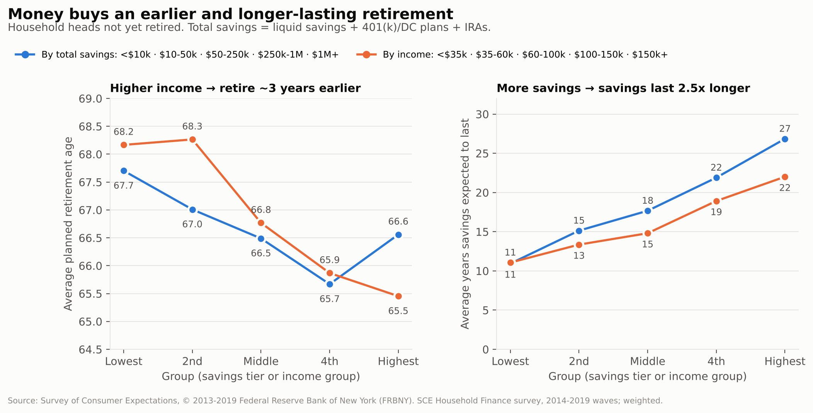
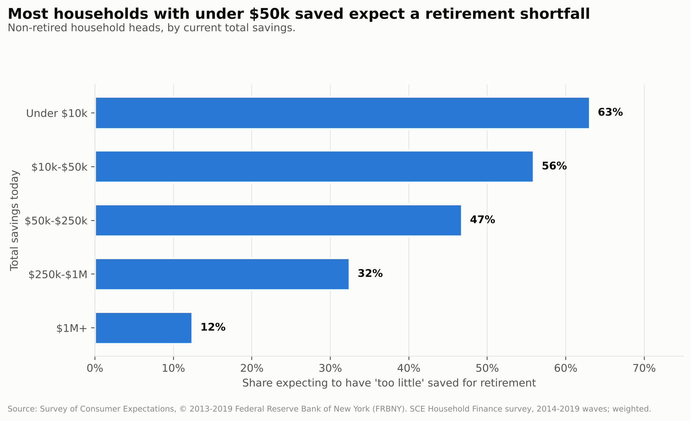

# Household Financial Resilience: Income, Debt, Shocks and Retirement Readiness

**Business Case Report — Advanced Data Analytics (Tableau Project)**
**Team:** Team Grit (Matthew Jones, Maria Mummau, Kellen Gradisar, Kiefer Cuppet)  **Date:** November 2026

---

## 1. Executive Summary

Using 6,809 household-head responses from the Federal Reserve Bank of New York's Survey of Consumer Expectations (SCE) Household Finance survey (2014–2019), we studied how income, debt and savings shape three things: day-to-day financial choices, debt risk, and retirement plans.

**Key findings**

1. **Income decides whether a household saves.** 62% of households earning $150k+ added more to savings than they withdrew, compared with only 15% of those earning under $35k. Half (51%) of the lowest-income group has no savings or investment account at all.
2. **Shocks wipe out much of that advantage.** After a large income drop or a decline in health, the share of net savers falls at every income level. In the $100k–$150k group it falls from 57% to 32%. Among households that drew down savings, 68% of those whose health declined named health as a reason, against 30% of everyone else.
3. **Bigger mortgages come with more consumer debt, not less.** Indebted households with a $250k+ mortgage carry about $73k of other debt on average, against about $29–38k for other groups. Because their incomes are higher, though, that debt is a *smaller* share of income (median 17% vs 47% for renters). Among mortgage holders, mortgage size and other debt are almost unrelated (Spearman ρ = 0.06).
4. **How people rate their credit lines up closely with how likely they think they are to default.** Respondents who say their score is below 620 put their own chance of bankruptcy in the next 12 months at 15.7% on average, about 7 times the 2.2% given by those above 760. 26% of those answering the housing question were 3+ months late on a payment in the past year, against under 1% of those above 760.
5. **More money buys an earlier and longer-lasting retirement.** People earning $150k+ plan to retire about 2.8 years earlier than those earning under $60k (65.5 vs 68.2–68.3). People with $1M+ saved expect their savings to last about 27 years, against 11 years for those with under $10k. 63% of households with under $10k saved expect to have "too little" for retirement.

**Recommendation in one line:** the most effective lever for household financial resilience is a liquid emergency cushion. It protects saving behavior when a shock hits, keeps households out of high-cost debt, and pushes out the retirement horizon. Banks, employers and policymakers should target it at lower-income and lower-credit households.

---

## 2. Business Problem and Objectives

Household balance sheets drive consumer spending, credit losses and retirement-security costs. Lenders, employers offering retirement plans, financial-wellness providers and policymakers all need to know **which households are most exposed and where an intervention moves outcomes most**.

**Objectives**

- Measure how household income relates to saving versus borrowing, and how that changes after an unexpected income or health shock.
- Understand how housing debt relates to the size and mix of other debt (credit cards, auto, student, medical), and whether self-rated credit predicts expected payment distress.
- Quantify how current savings and income relate to planned retirement age and to how long households expect their savings to last.

### Research questions

| # | Research question | Sub-questions investigated |
|---|---|---|
| RQ1 | How does a household's income affect whether it saves money or takes on debt, and how do those choices change when it has unexpected financial or health problems? | Do higher-income households save at higher rates? How does a large income drop or a decline in health change saving behavior? |
| RQ2 | How does the amount a household owes on its home relate to its other debt (credit cards, car loans, student loans, medical bills)? Does how people feel about their credit affect how likely they think they are to fall behind? | Do large mortgages come with higher card or medical balances? Do people who rate their credit lower expect more payment distress? |
| RQ3 | How do current savings and income affect when someone plans to retire and how long they expect their savings to last? | Do people with more savings plan to retire earlier? How many years do households expect their savings to cover? |

---

## 3. Data

| Item | Detail |
|---|---|
| Source | Federal Reserve Bank of New York, Survey of Consumer Expectations, Household Finance (SCE Housing/Household Finance microdata) — <https://www.newyorkfed.org/microeconomics/sce> |
| Coverage | 6 annual waves, each fielded in **August** of 2014, 2015, 2016, 2017, 2018 and 2019 |
| Rows | 6,809 responses (each `userid` appears once) |
| Columns | 397 variables, documented in the codebook sheet (`data/codebook.csv`) |
| Unit | U.S. household head, nationally representative internet panel |
| Weight | `quarterly_weights`, supplied by FRBNY. All shares and averages in this report are weighted. |

**Limitations.** Answers are self-reported, so amounts may be misremembered and financial distress may be under-reported. The panel loses members over time (attrition). Coverage is limited to U.S. households. Because the data are cross-sectional, we report associations, not causal effects. Some questions are answered only by subgroups (for example, only homeowners answer housing-debt questions), so sample sizes vary by chart. The survey has **no direct "will you miss a payment in the next 12 months" question**, so we use the self-rated percent chance of bankruptcy in the next 12 months as the forward-looking measure, and actual 3+ month housing delinquency as a backward-looking check.

---

## 4. Methodology

**Tools.** Python (pandas, numpy, matplotlib) for cleaning, weighted aggregation and the charts in this repository. Tableau for the interactive dashboards built from the same cleaned file (`data/processed/sce_household_finance_clean.csv`). Both tools read one cleaned dataset, so the numbers match.

**Why these methods.** The research questions compare groups (income bands, mortgage tiers, credit bands, savings tiers). Weighted group shares, averages and medians answer them directly and translate cleanly into Tableau. Spearman rank correlations measure strength of association because dollar amounts are heavily skewed and contain extreme values.

**Steps (reproducible in `src/`)**

1. **Extract** the `Data` and `Codebook` sheets from the FRBNY workbook.
2. **Clean and validate.** Remove impossible or extreme values (income above $5M; planned retirement ages outside 40–90; "years savings last" above 60). Map coded answers to labels using the codebook. Treat one undocumented code (`d2 = 5`, 2018–19 only) as missing.
3. **Derive variables.**
   - *Income group:* under $35k / $35–60k / $60–100k / $100–150k / $150k+.
   - *Saving behavior:* added more than withdrew / added as much / withdrew more / no account (question `d2`).
   - *Shock:* a large income **decrease** (`c3new1`) and/or a large short-term or permanent **deterioration in health** (`c3new3a`).
   - *Housing debt:* outstanding loans against the home (`f18new_1`) for owners with loans, $0 for owners without. Renters form their own group.
   - *Debt mix:* each debt type's percentage share (`g1a_*`) × total non-housing debt (`g1_1`).
   - *Total savings:* liquid savings (`d16new_1`) + defined-contribution (401k) balances (`c2new_1`) + IRA balances (`c2newx1_1`).
   - *Retirement:* planned retirement age (`i17_1`) and years savings are expected to last (`d24_1`), asked only of people not yet retired.
4. **Analyze.** Compute survey-weighted shares, means and medians by group, plus Spearman correlations.
5. **Visualize.** Six annotated charts using a colorblind-validated palette (`figures/`), and the matching Tableau dashboards.

---

## 5. Findings

### RQ1 — Income, saving vs. debt, and shocks

- The **net-saver share rises steadily with income**: 15% → 28% → 41% → 52% → 62%.
- The bigger divide is **access**: 51% of households under $35k have no savings or investment account, against 8% at $150k+. Their median liquid savings is $3k, against $80k at the top.
- **Debt is common at every income level** (75–85% hold some non-housing debt). Higher-income households borrow larger amounts (median $15–16k vs $5k), but they can cover a surprise $2,000 bill (89% average self-rated chance vs 47%), and 92% would pay it from their own savings, against 42% of the lowest-income group.

- Households hit by a **large income drop or a decline in health** are net savers less often at every income level. For example, $35–60k: 30% → 18%; $100–150k: 57% → 32%.
- Experiencing **both shocks** cuts the net-saver share to 11% (vs 38% with no shock). It also lowers the average self-rated ability to raise $2,000 from 71% to 36%, and more than doubles expected bankruptcy risk (10.2% vs 4.5%).
- Among households that withdrew from savings, **68% of those whose health declined** named reduced health as a reason, compared with 30% of other withdrawers. Health shocks show up directly as savings drawdowns.

### RQ2 — Housing debt vs. other debt; credit perception vs. distress

- Among households with non-housing debt, average balances grow with the mortgage: about $29k (owners with no mortgage) → $31k (under $100k) → $38k ($100k–$250k) → **$73k ($250k+)**. Credit-card balances roughly double ($8.9k → $18.5k) and auto loans rise about 60% ($10.9k → $17.1k) between the smallest and largest mortgage tiers.
- **Renters carry the most student debt** (about $15k average, almost half of their non-housing debt), which is plausibly a life-stage effect (households that have not bought a home yet), although age is not in this extract.
- **Medical debt is small in dollars** ($0.8–2.6k average) in every tier. It is not driven by mortgage size.
- High-mortgage households also earn more (median income $150k vs $32k for renters), so their **non-housing debt-to-income ratio is the lowest** (17%, against 47% for renters). Among mortgage holders, mortgage size and other debt are barely correlated (ρ = 0.06), while mortgage size and income are moderately correlated (ρ = 0.46). **We find no evidence that big mortgages "force" households into card or medical debt.** Both debts scale with income and lifestyle.

- Average self-rated chance of bankruptcy in the next 12 months falls with every step up in credit rating: **15.7% (below 620) → 6.1% → 4.6% → 3.0% → 2.2% (above 760)**.
- Actual distress follows the same pattern. 22% of the below-620 group *considered* bankruptcy in the past year (vs 0.5% above 760), and 26% of below-620 respondents who answered the housing-payment question (n = 66) were **3+ months late on a housing payment** in the past year (vs 0.7%).
- The weak-credit group also has the least cushion: an average 31% chance of being able to raise $2,000 in a month, against 88% for those above 760.
- Respondents who **don't know their score** (n = 315) look closer to the 620–679 group (8.7% expected bankruptcy risk). Not knowing your score is itself a warning sign.

### RQ3 — Savings, income and retirement

- **Higher income means an earlier planned retirement.** The average planned age falls from 68.2 (under $35k) to 65.5 ($150k+).
- **Savings show the same direction up to $1M.** Planned age goes 67.7 → 67.0 → 66.5 → 65.7. It ticks back up to 66.6 for the small $1M+ group (n = 179). That may reflect wealthy professionals choosing to keep working, but this extract has no age variable to test it.
- The **expected years savings will last rises steeply with savings**: 11 years (under $10k) → 15 → 18 → 22 → **27 years ($1M+)**. Savings and expected years correlate at ρ = 0.41.
- Planned retirement age and years savings will last are negatively correlated (ρ = −0.27). Households with thin savings plan to work longer *and* still expect their money to run out sooner.

- **63% of households with under $10k**, and 56% of those with $10–50k, expect to have "too little" saved for retirement, against 12% of those with $1M+.

---

## 6. Insights and Recommendations

| Insight | Recommendation | Who acts |
|---|---|---|
| Half of lower-income households have no savings account, and a shock pushes even middle-income households out of saving. | Offer **automatic emergency-savings accounts** (payroll split, or "sidecar" accounts next to a 401(k)) with no-fee, instant access. Target $2,000 as the first milestone. | Employers, banks, fintechs |
| Health shocks are the most direct cause of savings drawdowns. | Pair health benefits with **HSA contributions and short-term disability coverage**. Add health-event triggers to financial-wellness outreach. | Employers, insurers |
| Self-rated credit strongly predicts expected and actual delinquency, and "don't know my score" is a risk flag. | Use **free credit-score access and early-warning outreach** for customers who report weak or unknown credit. Offer hardship plans before the 90-day delinquency point. | Lenders, servicers |
| High mortgages come with higher consumer debt in dollars, but not as a share of income. | Underwrite on **debt-to-income and liquidity**, not on mortgage size alone. Watch renters' high student-debt-to-income ratio. | Lenders, regulators |
| Low savers plan to work longer yet expect their money to run out sooner. | **Auto-enrollment and auto-escalation** in retirement plans. Retirement-income projections at enrollment. Targeted catch-up messaging for households under $50k. | Employers, plan providers, policymakers |

**Next steps for analysis.** Add age and education controls (from the SCE core survey) to separate the effect of income from life stage. Build a simple risk score (credit band × liquidity × shock) and validate it against reported 3-month delinquency. Extend the series to waves after 2019 to test resilience during the COVID-19 period.

---

## 7. Data Attribution

Source: Survey of Consumer Expectations, © 2013–2019 Federal Reserve Bank of New York (FRBNY). The SCE data are available without charge at <http://www.newyorkfed.org/microeconomics/sce> and may be used subject to license terms posted there. FRBNY disclaims any responsibility or legal liability for this analysis and interpretation of Survey of Consumer Expectations data.
